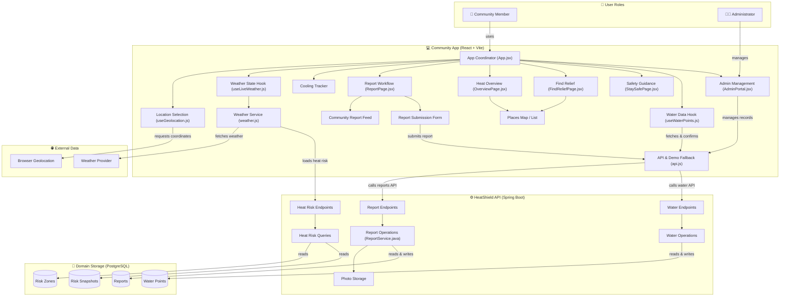

# ☀️ HeatShield — Community Heat-Risk & Water-Access Platform 🚰

[](https://spring.io/projects/spring-boot)
[](https://react.dev/)
[](https://vitejs.dev/)
[](https://www.postgresql.org/)
[](https://aws.amazon.com/amplify/)

> **HeatShield** is a smart, community-driven platform designed to provide real-time monitoring, alerts, and access mapping for urban heatwaves, heat-risk zones, and public drinking water sources.

---

## 🌟 Key Features

* 🗺️ **Interactive Heat-Risk Mapping:** Real-time temperature, "feels like" metrics, and geographic heat risk level visualization.
* 💧 **Water Point Location & Status Tracker:** Operational status tracking (`OPERATIONAL`, `LOW_SUPPLY`, `BROKEN`) for public taps, kiosks, fountains, and tanker points.
* 🚨 **Automated Heat Advisories:** Live safety guidelines, temperature threshold alerts, and preventive health measures.
* 📣 **Community Reporting System:** Allows citizens and volunteers to report real-time water source issues, infrastructure defects, or heat hazards.
* ⚡ **High Performance & Modern UI:** Built with React + Vite on the frontend and robust Spring Boot REST APIs on the backend.

---

## 📐 System Architecture & Workflow

Below is the detailed flow diagram representing the interaction between Community Members, Administrators, Frontend React Components, Spring Boot API Endpoints, and Domain Storage.



---

## 🛠️ Tech Stack

### 💻 Frontend
* **Framework:** React 18 (Vite Build Tool)
* **Styling:** Custom CSS3 & Responsive UI Components
* **Code Quality:** Oxlint & ESLint rules

### ⚙️ Backend
* **Framework:** Java 17, Spring Boot 3.5.6
* **Database:** PostgreSQL with Spring Data JPA
* **Health Monitoring:** Spring Boot Actuator

---

## 📂 Project Structure

```plaintext
HeatShield/
├── src/                          # 🎨 React Frontend Code
│   ├── assets/                   # Images, Icons & SVGs
│   ├── components/               # React Components (Dashboard, HeatRiskMap, ReportForm, etc.)
│   ├── data/                     # Offline Fallback / Mock Data
│   └── services/                 # Axios / Fetch API integrations
├── src/main/java/com/heatshield/ # ⚙️ Spring Boot Java Backend
│   ├── config/                   # CORS, Security & DataSeeder Configurations
│   ├── controller/               # REST Endpoints (Health, HeatRisk, WaterPoints)
│   ├── dto/                      # Data Transfer Objects
│   ├── entity/                   # JPA Relational Entities
│   ├── repository/               # Data Access Repositories
│   └── service/                  # Business Logic Layer
├── pom.xml                       # 📦 Maven Project Dependencies
├── vite.config.js                # ⚡ Vite Configuration
└── README.md                     # 📖 Project Documentation
```

---

## 🚀 Getting Started

### 📋 Prerequisites

Make sure the following tools are installed on your machine:

* 🟢 Node.js (v18+ recommended)
* ☕ Java JDK (v17 or higher)
* 🐘 PostgreSQL Server
* 📦 Maven

### 🗄️ 1. Backend Setup (Spring Boot)

**Database Configuration:**

Start PostgreSQL and update your database credentials in `application.properties`:

```properties
spring.datasource.url=jdbc:postgresql://localhost:5432/heatshield
spring.datasource.username=your_username
spring.datasource.password=your_password
spring.jpa.hibernate.ddl-auto=update
```

**Run Backend Server:**

```bash
./mvnw spring-boot:run
```

The backend starts at `http://localhost:8080` and seeds initial demo data into the database.

**Verify API:**

Navigate to `http://localhost:8080/api/health` in your browser.

### 💻 2. Frontend Setup (React + Vite)

**Install Dependencies:**

```bash
npm install
```

**Environment File Configuration:**

Create a `.env` file in the root directory based on `.env.example`:

```env
VITE_API_URL=http://localhost:8080/api
```

**Start Development Server:**

```bash
npm run dev
```

The application will open at `http://localhost:5173`.

---

## 📡 Key API Endpoints

| Method | Endpoint | Description |
|--------|----------|-------------|
| GET | `/api/health` | Health check endpoint |
| GET | `/api/heat-risk/current` | Live temperature & heat risk advisory |
| GET | `/api/heat-risk/zones` | Bounding box coordinates for heat risk zones |
| GET | `/api/water-points` | Public water access locations and statuses |
| POST | `/api/reports` | Submit community heat/water reports |

---

## 👨‍💻 Contributors

Special thanks to the team behind HeatShield:

<table>
  <tr>
    <td align="center">
      <a href="https://github.com/aryansangal100-ship-it">
        <br />
        <sub><b>Aryan Sangal</b></sub>
      </a><br />
      <sub>Full-Stack Development & AWS Deployment</sub>
    </td>
    <td align="center">
      <a href="https://github.com/Suryanshsah">
        <br />
        <sub><b>Suryansh Sah</b></sub>
      </a><br />
      <sub>Core Architecture & System Design</sub>
    </td>
    <td align="center">
      <a href="https://github.com/dhwlpandey">
        <br />
        <sub><b>Dhawal Pandey</b></sub>
      </a><br />
      <sub>Backend Developer & API Infrastructure</sub>
    </td>
    <td align="center">
      <a href="https://github.com/anirudhagarwal-dev">
        <br />
        <sub><b>Anirudh Agarwal</b></sub>
      </a><br />
      <sub>Core Contributor & Team Role</sub>
    </td>
  </tr>
</table>

---

## 📄 License

This project is open-source and released under the MIT License.
heloo